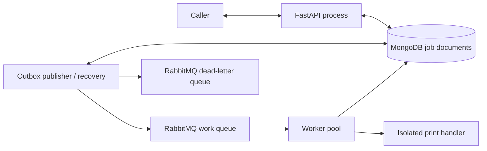
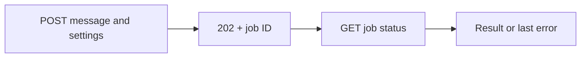
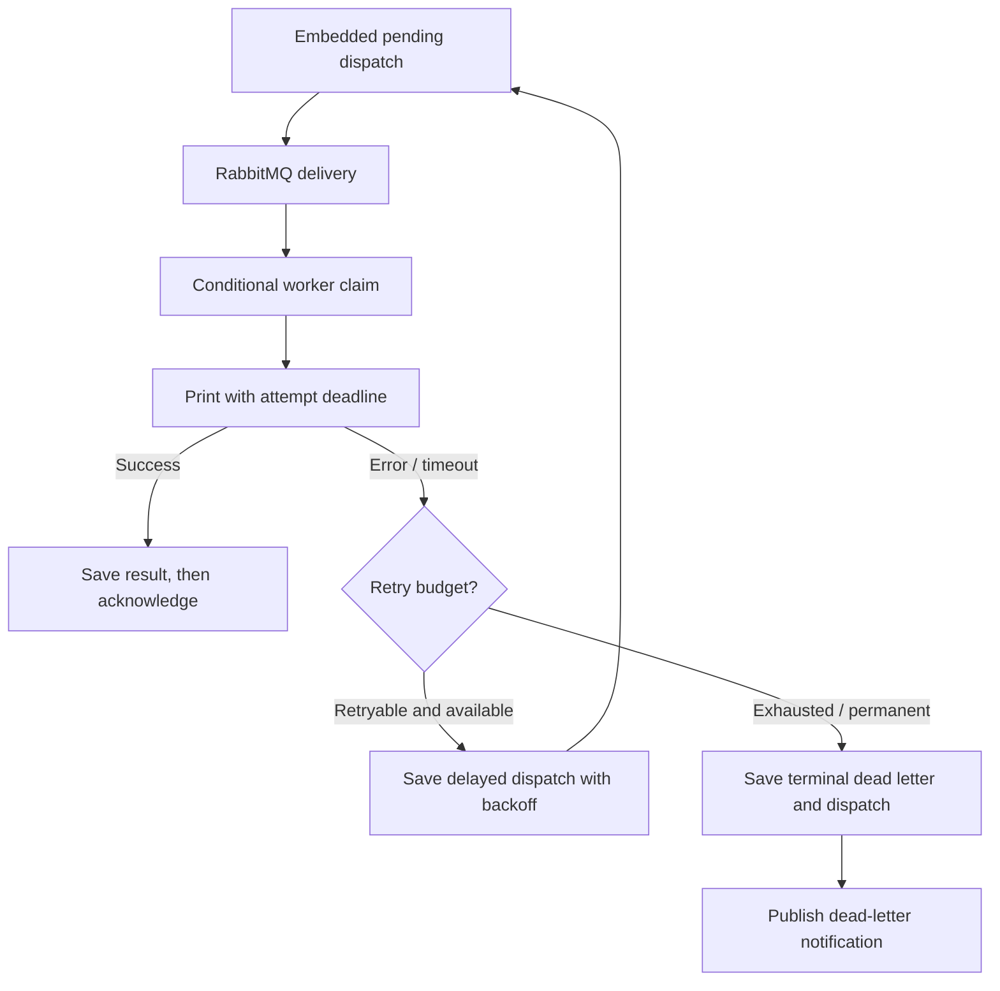

# Task Scheduler API

A FastAPI job API that submits messages, processes them in a separate worker pool,
and stores status/results in MongoDB. Includes retries, hard attempt timeouts,
dead letters, queue visibility, cancellation, and drain/resume. GitHub Actions
can deploy the API and worker to DigitalOcean App Platform after tests pass.

The API has no authentication. Put it behind an authentication layer before
exposing it publicly.

## Setup

Requires Python 3.12+ and running MongoDB 8.0 / RabbitMQ 4.1 with the management
plugin. Docker Compose is optional local tooling for starting those two services;
it does not deploy the application.

From the project directory, in PowerShell:

```powershell
python -m venv .venv
.\.venv\Scripts\Activate.ps1
python -m pip install -c requirements-dev.lock -e ".[dev]"
Copy-Item .env.example .env
docker compose up -d --wait
python -m uvicorn job_api.api:app --host 127.0.0.1 --port 8000
```

If script execution is restricted, invoke `.\.venv\Scripts\python.exe` directly
instead of activating the environment. If services are already running, skip
Compose and configure their URLs in `.env`.

In a second terminal:

```powershell
.\.venv\Scripts\Activate.ps1
python -m job_api.pool --workers 3
```

The pool starts three worker processes plus one coordinator for outbox
publication and expired-attempt recovery. Each worker runs one handler child
process at a time. Open <http://127.0.0.1:8000/docs> for the API or
<http://127.0.0.1:15672> for RabbitMQ's local management UI (`guest` / `guest`).

Stop the API/pool with Ctrl+C. `docker compose stop` stops local services without
deleting their persistent volumes.

## Architecture



MongoDB stores one document per job with `_id = job ID`. State and pending
dispatch are updated atomically in that document. No sharding or partition key
is needed for this local workload. If sharding is needed later, evaluate hashed
`_id` against both job-ID lookups and cross-job dispatch/recovery scans.

## User flow



```powershell
$job = Invoke-RestMethod -Method Post -Uri http://127.0.0.1:8000/jobs `
  -ContentType application/json `
  -Headers @{ "Idempotency-Key" = "my-first-job" } `
  -Body '{"payload":{"message":"Hello from the worker"},"priority":5,"max_retries":3,"timeout_seconds":10}'

Invoke-RestMethod "http://127.0.0.1:8000/jobs/$($job.job_id)"
```

Submission returns only after a durable MongoDB write, but does not wait for
RabbitMQ or handler execution. A successful result is:

```json
{
  "printed": true,
  "message": "Hello from the worker"
}
```

The optional idempotency key returns the original job for the same normalized
request and returns `409` for different content. Without a key, every submission
creates a new job. Keys remain effective while their job document is retained.

## Background execution



The coordinator polls MongoDB for due embedded dispatch records. It publishes
persistent messages with publisher confirms and mandatory routing, then
conditionally clears the matching dispatch. Publication failures retain the
record with bounded retry delay. Workers subscribe to RabbitMQ; they do not
poll MongoDB for new work.

States: `queued`, `running`, `failed` (retry pending), `succeeded`,
`dead-lettered`, `cancelled`. `GET /jobs/{id}` always includes attempt count,
last error, result, and completed attempt history. A running attempt increments
the counter immediately; its history entry is appended when finalized.

- `max_retries = N` allows at most `N + 1` claimed attempts.
- Retry delay is full jitter: `random(0, min(cap, base * 2^(attempt - 1)))`.
- Handler execution includes process-startup time in the attempt deadline.
- The child process is terminated on timeout. A parent-death watcher also
  stops the child if its worker exits, for handlers that permit Python threads
  to run; arbitrary native code that holds the GIL is not guaranteed to cooperate.
- Recovery checks leases after the attempt deadline plus recovery grace.
  A crashed worker's job can therefore wait up to its configured timeout before
  recovery; this implementation does not use early heartbeat-based job leases.
- Exhaustion/permanent failure is retained in the job document, with an outbox
  notification to `jobs.dead`. Broker-rejected malformed messages also reach
  this queue through the configured dead-letter exchange.

The registered production handler is `print`. To add another trusted handler,
implement the `Handler` protocol, add it to the registry and its payload
validation, and test its retry/side-effect behavior. Never run submitted code.
Test-only handlers are disabled unless `ENABLE_TEST_HANDLERS=true`.

## Operational endpoints

| Endpoint | Behavior |
|---|---|
| `GET /jobs/{id}` | Authoritative MongoDB job status/result |
| `POST /jobs/{id}/cancel` | Cancel queued/retry-waiting work; repeat cancellation is safe |
| `GET /queue/depth` | Separate broker ready/unacknowledged/dead counts and database pending/delayed/dead counts |
| `POST /queue/drain` | Persist `draining`; reject new admissions and pause new work |
| `GET /queue/control` | Mode, running count, live/paused workers, and drain completion |
| `POST /queue/resume` | Persist `active` and resume processing |
| `GET /health` | MongoDB readiness; does not imply the broker/pool is healthy |

Drain returns `202`: it is **asynchronous quiescing**, not processing or deleting
the entire backlog. Running attempts finish; dead-letter notifications can
still publish. Queue mode lives in MongoDB's separate `queue_control` document.
Workers cancel their subscriptions after observing drain. Completion means
no running jobs and all recently seen workers report the current paused
generation.

Control checks and job updates are separate documents, so an admission/claim
already past its check can race a drain request. This is a converging pause,
not a globally atomic stop barrier; completion is an observed snapshot, not
a guarantee about unresponsive processes. Resume/drain survive application
restarts.

Cancellation is an atomic job-state update. RabbitMQ messages already queued
are acknowledged without execution when workers see `cancelled`. Running and
other terminal jobs return `409`; unknown IDs return `404`.

Depth combines separately sampled stores. RabbitMQ statistics refresh
periodically and count messages, not unique jobs, so do not add the categories
together as an exact job total. Unavailable statistics return `503`, never
invented zero counts.

## Delivery guarantees

Accepted, noncancelled work remains durable under the configured database and
broker guarantees and can be redelivered/recovered within its finite attempt
budget. Database failure returns `503`; RabbitMQ failure does not lose saved
pending dispatch.

Conditional claims prevent simultaneous ownership of the same attempt.
Generation/token checks skip obsolete notifications and reject stale writes.
Outcomes commit before acknowledgement.

**Exactly-once printing is not guaranteed:** a worker can print, crash before
saving success, and print again on retry. Real side effects need downstream
idempotency using the stable job ID. Repeated broker publication does not itself
consume another attempt; only a successful execution claim does.

These guarantees do not cover permanent data loss, retry exhaustion, deliberate
cancellation, arbitrary native handler behavior, or indefinite dependency
outages. A single-node local broker/database is not an HA deployment.

## Worker configuration and high load

See `.env.example`. Important settings:

| Setting | Default |
|---|---|
| `WORKER_COUNT` | 3, override with `--workers` |
| `POLL_INTERVAL_SECONDS` | 5 |
| `BACKOFF_BASE_SECONDS` / `BACKOFF_CAP_SECONDS` | 1 / 30 |
| `RECOVERY_GRACE_SECONDS` | 5 |
| `SHUTDOWN_GRACE_SECONDS` | 10 |
| `ENABLE_TEST_HANDLERS` | false |

Submission limits: priority `0..9`, retries `0..10`, timeout `(0, 3600]`
seconds, message up to 16,384 characters, payload/result up to 256 KiB.
Each worker has prefetch `1`. Priority orders buffered work, not already-running
attempts; sustained high-priority traffic can starve lower priorities.

Bound worker count and connection pools to downstream capacity. Monitor backlog
age, retry rates, expired attempts, and database dispatch scans. The publisher
handles bounded batches and has an indexed due-time query. Admission quotas,
fairness, automated retention, authentication, observability dashboards, load
certification, and HA/restore drills are production follow-ups.

## Tests and CI

```powershell
python -m ruff check .
python -m ruff format --check .
python -m pytest -q
```

The default suite runs unit/API tests with mongomock and real isolated handler
processes. It explicitly skips service-backed tests.

With MongoDB and RabbitMQ running:

```powershell
python -m pytest --integration -q
```

Integration tests use unique databases/queues, real workers, and clean up only
their own test resources. They cover results, retries/exhaustion, hard timeouts,
duplicate messages, worker crashes/stale writes, pool concurrency, priority,
cancelled buffered jobs, drain/resume, and depth. Publisher failure is injected
without shutting down shared services.

GitHub Actions starts MongoDB/RabbitMQ services and runs lint, formatting, and
the full suite on pull requests and pushes to `main`. A successful push to
`main` then provisions or updates the DigitalOcean resources and deploys the
application. Manual workflow runs also provision/update and deploy after tests
succeed.

## DigitalOcean deployment

The deployment script `.github/scripts/deploy_digitalocean.py` creates or
reuses these resources in Singapore (`sgp1` for Droplets/databases and `sgp` for
App Platform):

- A VPC (`10.70.0.0/20`) for private service traffic.
- A DigitalOcean Managed MongoDB 8 cluster (`db-s-1vcpu-1gb`, one node).
- RabbitMQ from Ubuntu 24.04 packages on a Droplet (`s-1vcpu-2gb`). It stores
  broker data on the Droplet's persistent disk. RabbitMQ has one node, so it
  is a single point of failure.
- An App Platform app with separate API and worker components, each starting
  at one `apps-s-1vcpu-1gb` instance. The API is exposed over HTTPS; worker,
  MongoDB, and RabbitMQ traffic uses the private VPC network.

Before the first deployment, add these GitHub repository Actions secrets:

| Secret | Purpose |
|---|---|
| `DIGITALOCEAN_ACCESS_TOKEN` | DigitalOcean API token that can manage VPCs, databases, Droplets, firewalls, tags, and App Platform apps, and has `database:view_credentials` permission. The deploy script reads the private MongoDB endpoint from the cluster response and gets the password from the database user endpoint if it is absent there. |
| `RABBITMQ_PASSWORD` | Password for the RabbitMQ application user; use at least 24 characters and keep it stable after the first provision |

Optional GitHub Actions variables control independent App Platform scaling:

| Variable | Default | Purpose |
|---|---:|---|
| `DO_API_INSTANCES` | `1` | Number of API instances |
| `DO_WORKER_INSTANCES` | `1` | Number of worker instances |

Pushes to `main` provision missing resources, update the app spec, and wait for
the deployment after all tests pass. `workflow_dispatch` does the same when
started from `main`. Pull requests only run tests. The script uses stable
resource names and does not delete resources; deleting this infrastructure
must be done deliberately from DigitalOcean. Resource creation incurs ongoing
DigitalOcean charges. The selected one-node MongoDB and RabbitMQ configurations
do not provide full high availability for both data services.

RabbitMQ's management and AMQP ports are restricted to the VPC. The deployment
uses App Platform's VPC integration to reach the broker and MongoDB privately.
The MongoDB cluster firewall allows the project VPC CIDR. The API health check
checks MongoDB readiness; it does not prove RabbitMQ or worker health. The API
also has no authentication, so add an authentication layer before exposing it
to untrusted callers.
